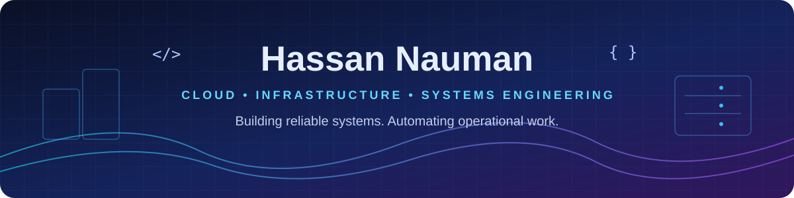

# Hassan Nauman

### Cloud Infrastructure · Systems Engineering · Automation

**AWS** · **Azure** · **Linux** · **Windows Server** · **Networking** · **Monitoring** · **DevOps**

*Building and automating reliable cloud and enterprise systems.*

---

### 👋 About Me

I'm a Computer Science graduate from the **University of Manitoba** with experience supporting enterprise healthcare applications and infrastructure integrations. My work has involved incident investigation, access management, application troubleshooting, integration testing, and cloud migration support.

I'm building toward **cloud infrastructure, platform engineering, and systems engineering**, with a focus on operational reliability, automation, and practical hands-on labs.

- 🔭 **Building:** AWS monitoring, Windows/Active Directory, and infrastructure automation projects
- 🛠️ **Working with:** Python, PowerShell, Bash, AWS, Azure, Linux, Windows Server, and networking
- 📚 **Learning:** Advanced systems, infrastructure-as-code, and platform operations
- 🎯 **Interested in:** Cloud operations, reliability engineering, and infrastructure consulting

### 🧰 Tech Stack

### 🚀 Featured Projects

| Project | What it demonstrates |
|---|---|
| ☁️ **[AWS Windows & Active Directory Lab](https://github.com/hassannauman123/aws-windows-AD)** | Windows Server, AD DS, DNS, identity management, and AWS networking |
| 🏥 **[Diagnostic Imaging Reconciliation Platform](https://github.com/hassannauman123/diagnostic-imaging-reconciliation-platform)** | Event-driven healthcare-inspired workflow automation and cloud services |
| 🚨 **AWS Application Error Monitoring** | CloudWatch Logs, metric filters, alarms, SNS, and Lambda for simulated application error alerting *(link after publishing)* |

### 📊 GitHub Activity

---

**Interested in cloud infrastructure, systems engineering, and practical automation.**

[View my repositories](https://github.com/hassannauman123?tab=repositories)

